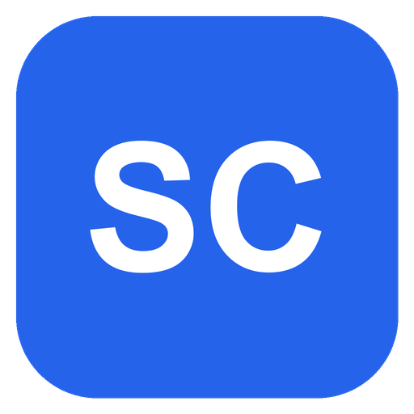
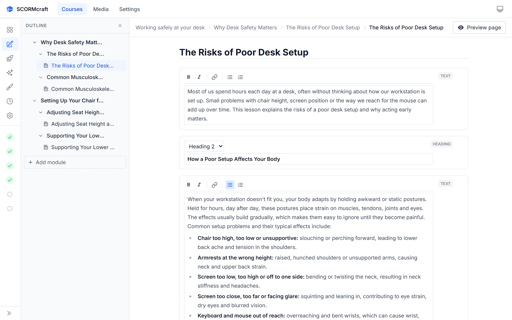
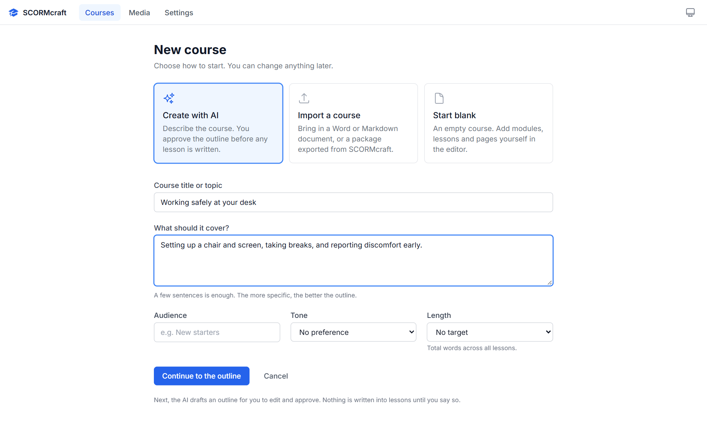
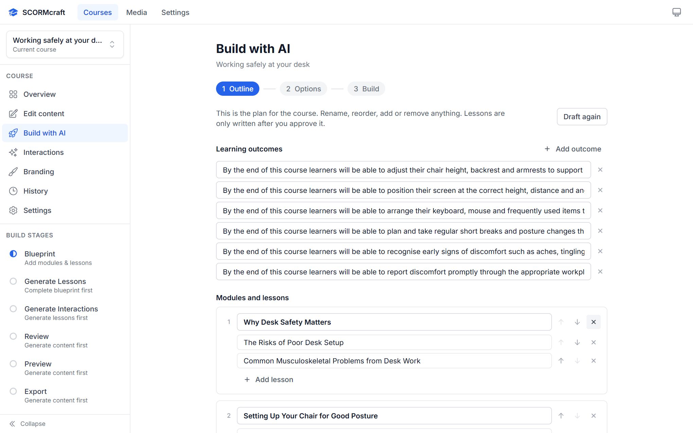
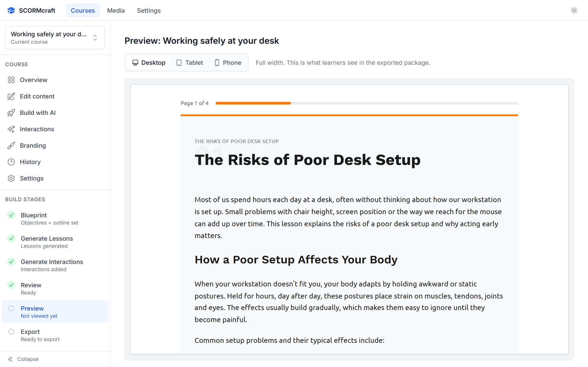
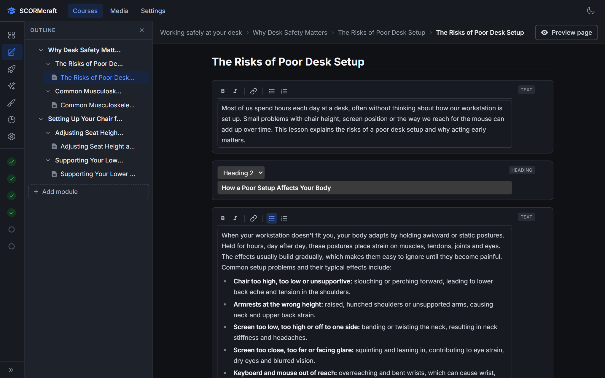

<div align="center">



# SCORMcraft

**Write a training course with AI, edit it block by block, and export a SCORM package your LMS can run.**

A Windows desktop app. Your courses stay on your computer.

[](https://github.com/davidweller/scormcraft/releases/latest)
[](LICENSE)


[What it does](#what-it-does) · [Install](#install) · [Quick start](#quick-start) · [AI providers](#ai-providers) · [Documentation](#documentation) · [Development](#development)

</div>



## What it does

SCORMcraft takes you from a topic, or a document you already have, to a finished e-learning course.

- **Three ways to start.** Describe a course and let AI draft it, import a Word or Markdown document, or start blank.
- **AI that asks first.** The AI drafts an outline. Nothing is written into lessons until you've edited and approved it.
- **A block editor.** Text, headings, images, video, tables, key points and file downloads. Drag to reorder, or add a block anywhere with the + between blocks.
- **Six kinds of interaction.** Multiple choice, true or false, reflection, drag and drop, matching and flip cards.
- **Your content is protected.** AI only writes into empty lessons unless you say otherwise, rewrites are shown beside the original before you accept them, and History keeps the last 25 versions of each course.
- **Your branding.** Colours, fonts, logo and three learner layouts.
- **Preview and export.** Check the course at desktop, tablet and phone widths, then export SCORM 1.2 or a Word document.
- **Local by design.** Courses live in a SQLite file and uploads sit in a folder on your computer. There's no account and no server.

| Start a course | Approve the outline |
|---|---|
|  |  |

| Preview as a learner | Dark theme |
|---|---|
|  |  |

## Install

You need Windows 10 or 11.

1. Open the [latest release](https://github.com/davidweller/scormcraft/releases/latest).
2. Download `SCORMcraft-Setup-<version>.exe`.
3. Run it. The installer isn't code-signed, so Windows SmartScreen will warn you the first time; choose **More info**, then **Run anyway**.

Your courses are kept in `%APPDATA%\SCORMcraft\data`. Installing a newer version over an older one keeps them, and uninstalling the app leaves that folder alone.

### Build it yourself

You need [Node.js](https://nodejs.org) 20 or later, and Git. It takes about 5 minutes.

```bash
git clone https://github.com/davidweller/scormcraft.git
cd scormcraft
npm install
npm run desktop:build:win
```

The installer is written to `dist/SCORMcraft-Setup-<version>.exe`.

## Quick start

1. Open SCORMcraft and go to **Settings**. Sign in to a Claude or ChatGPT subscription, or paste in an API key. See [AI providers](#ai-providers).
2. Choose **New course**, then **Create with AI**, and describe what the course should cover.
3. Edit the outline the AI drafts: rename, reorder, add or remove modules and lessons. Choose **Approve outline**.
4. Decide whether to add interactions, then choose **Build the course**. Lessons are written one at a time and you can stop at any point.
5. Open the editor to change anything, **Preview** to see it as a learner, then **Export** to download the SCORM package.

You don't need AI to write a course: **Start blank** opens an empty course in the editor. Importing a Word or Markdown document does use AI, to work out the document's structure; your wording is kept as written.

## AI providers

Pick one in **Settings**. A course can override it in its own settings.

| Provider | What you need |
|---|---|
| Claude subscription | [Claude Code](https://claude.com/claude-code) installed and signed in with a Pro or Max plan |
| ChatGPT subscription | The Codex CLI (`npm install -g @openai/codex`), signed in with a ChatGPT plan |
| OpenAI API | An OpenAI API key |
| Anthropic API | An Anthropic API key |

The subscription options run the official command-line tool on your own computer, so usage counts against your plan and no API key is needed. Generating images needs a Google Gemini API key.

API keys are stored in a settings file on your computer. Course content is sent to the provider you choose only when you use an AI feature: building a course, rewriting a block, generating interactions or importing a document.

## Documentation

| Guide | What's in it |
|---|---|
| [User guide](docs/user-guide.md) | Every journey through the app: starting, editing, AI, importing, history, branding, preview and export |
| [Adding downloadable files](docs/file-downloads.md) | Attaching worksheets, templates and spreadsheets to a course |
| [Development guide](docs/development.md) | Running from source, how the app is put together, database changes and releases |
| [Changelog](CHANGELOG.md) | What changed in each version |

## Development

```bash
npm install
npm run dev
```

This opens the app in an Electron window with its data in `.desktop-data/`. The database is created and updated at startup.

| Command | What it does |
|---|---|
| `npm run dev` | Runs the app from source |
| `npm run test` | Unit tests (Vitest) |
| `npm run lint` | ESLint |
| `npm run db:migrate -- --name <change>` | Writes a migration after a change to `prisma/schema.prisma` |
| `npm run desktop:build:win` | Builds the Windows installer |

Built with Next.js 14, React, TypeScript, Tailwind, Prisma on SQLite, and Electron. The [development guide](docs/development.md) covers the architecture.

## Status

SCORMcraft is a personal project in active development. It began as a hosted web app; that version was retired in November 2026 and the app is now desktop only. The original product documents are kept in [docs/archive](docs/archive) for history and no longer describe how it works.

Known limits:

- Windows only.
- SCORM 1.2 only. SCORM 2004 isn't available yet.
- SCORM import reads packages exported from SCORMcraft, not packages from other tools.

## Licence

[MIT](LICENSE). You can use, change and share SCORMcraft, including commercially, as long as you keep the copyright notice.
