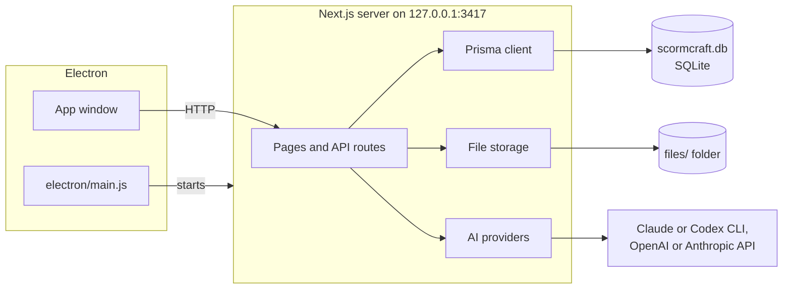

# Development guide

How to run SCORMcraft from source, how it's put together, and how to change it safely.

- [Running from source](#running-from-source)
- [Commands](#commands)
- [How it fits together](#how-it-fits-together)
- [Where things live](#where-things-live)
- [Changing the database](#changing-the-database)
- [The design system](#the-design-system)
- [How content is protected](#how-content-is-protected)
- [Testing](#testing)
- [Releasing](#releasing)

## Running from source

You need Windows 10 or 11 and Node.js 20 or later.

```bash
npm install
npm run dev
```

`npm run dev` starts a Next.js dev server on `http://127.0.0.1:3417` and opens it in an Electron window. Data goes in `.desktop-data/` in the project folder, separate from an installed copy's data.

API keys are optional. Add them in the app's Settings, or copy `.env.example` to `.env`.

## Commands

| Command | What it does |
|---|---|
| `npm run dev` | Runs the app from source (same as `desktop:dev`) |
| `npm run test` | Unit tests, once |
| `npm run test:watch` | Unit tests, re-running on change |
| `npm run lint` | ESLint |
| `npm run db:generate` | Regenerates the Prisma client |
| `npm run db:migrate -- --name <change>` | Writes a migration for a schema change |
| `npm run desktop:build` | Builds the standalone server bundle only |
| `npm run desktop:build:win` | Builds the Windows installer into `dist/` (about 5 minutes) |

Stop the dev server before `db:generate`, `db:migrate` or a build. It holds the Prisma engine file open and the command fails with `EPERM`.

## How it fits together

SCORMcraft is a Next.js app that runs entirely on the user's computer. Electron provides the window and starts the server; there is no remote backend.



- **`electron/main.js`** starts the server and opens the window. In a packaged app it forks the standalone Next.js server; in development it waits for `electron/dev-server.js`.
- **`electron/env.js`** builds the server's environment, so development and the packaged app can't drift:

  | Variable | Points at |
  |---|---|
  | `DATABASE_URL` | The SQLite file |
  | `STORAGE_DIR` | The uploads folder |
  | `SETTINGS_PATH` | `settings.json` |
  | `MIGRATIONS_DIR` | The migrations to apply at startup |

- **Data folder:** `%APPDATA%\SCORMcraft\data` when installed, `.desktop-data/` in development. Server logs go to `%APPDATA%\SCORMcraft\logs\server.log`.
- **Startup:** `src/instrumentation.ts` runs `src/lib/desktop/migrate.ts`, which brings the database up to date before the first request.

## Where things live

| Path | What's there |
|---|---|
| `src/app/` | Pages and API routes (Next.js App Router) |
| `src/app/courses/[courseId]/` | One folder per course screen: `edit`, `build`, `history`, `branding`, `preview`, `export` and so on |
| `src/app/api/` | The HTTP API the pages call |
| `src/components/ui/` | The shared UI kit |
| `src/components/course-editor/` | The outline tree and block editor |
| `src/lib/llm/` | AI providers behind one interface (`LlmProvider`) |
| `src/lib/ai.ts` | The prompts: outline, lesson text, interactions, rewrites |
| `src/lib/scorm/` | SCORM export (`build-package.ts`, `render-page-html.ts`) and import (`import/`) |
| `src/lib/blob.ts` | File storage under `STORAGE_DIR` |
| `src/lib/snapshots.ts` | Course history |
| `prisma/` | The schema and its migrations |
| `electron/` | The desktop shell |
| `scripts/` | Build and database helpers |

Two rules that are easy to trip over:

- Server code that needs a stored file's bytes must use `fetchStored` from `src/lib/blob.ts`, not `fetch`. Stored files have relative `/files/...` urls, which the server can't fetch from itself.
- Import `prisma` and `JsonNull` from `src/lib/db.ts`. Import `Prisma` from `@prisma/client` for types only.

## Changing the database

The schema is `prisma/schema.prisma`, on SQLite.

1. Stop the dev server.
2. Edit `prisma/schema.prisma`.
3. Run `npm run db:migrate -- --name describe_the_change`.
4. Commit the new folder in `prisma/migrations/`.

`db:migrate` works on a scratch database (`.desktop-data/migrate-scratch.db`), never on real data. The app applies new migrations itself at its next start, in development and when installed. The packaged app has no Prisma CLI, which is why `src/lib/desktop/migrate.ts` runs the SQL files directly and records them in a `_desktop_migrations` table.

Migrations only ever run forwards on users' machines, so write them to be safe on existing data: add columns with defaults, and don't drop anything a previous version still reads.

## The design system

Colours are CSS variables in `src/app/globals.css`, exposed to Tailwind in `tailwind.config.ts`. A theme is one block of values, so components need no `dark:` variants.

- Use `brand-*` for the app's own colour, `gray-*` for neutrals, `bg-surface` for cards and panels, and `red`, `amber` and `green` for status.
- Avoid `bg-white` and raw `blue-*` or `indigo-*`. They ignore the theme and break dark mode.
- Build screens from `src/components/ui/`: `Button`, `Dialog`, `Field`, `Input`, `Select`, `Card`, `EmptyState`, `Spinner`, `Skeleton`.
- Use `useConfirm()` and `useToast()` in place of the browser's `confirm()` and `alert()`.
- Icons come from Heroicons only.

## How content is protected

These behaviours are deliberate. Keep them when changing nearby code.

- **Blueprint saves are in place.** `src/lib/blueprint-apply.ts` matches modules and lessons by id, so a save updates titles and order and deletes only what the author removed.
- **Generation fills empty lessons.** `src/lib/generate-lesson-pages.ts` refuses a lesson that has content unless the caller passes `overwrite`, and even then replaces only text and heading blocks.
- **Snapshots come first.** Deleting a module, lesson or page, regenerating a lesson, and a blueprint save that removes lessons each call `takeSnapshot` before changing anything.
- **Rewrites are previewed.** The block regenerate route returns a proposal without saving; the author chooses Replace, Insert below or Discard.
- **AI replies are parsed defensively.** `completeJsonObject` in `src/lib/llm/json.ts` retries once when a reply isn't valid JSON.

## Testing

Unit tests are Vitest, beside the code they cover (`*.test.ts`). They run without a database, file storage or an AI provider.

```bash
npm run test
npm run test -- src/lib/outline.test.ts
npm run test -- -t "retries once"
```

There are no end-to-end tests. Before a release, check by hand in the packaged app: create a course with AI, import a document, drag a lesson between modules, restore a version from History, and export SCORM.

To try a packaged build without touching your own courses, point it at a spare data folder:

```bash
dist\win-unpacked\SCORMcraft.exe --user-data-dir=C:\temp\scormcraft-test
```

## Releasing

1. Update `CHANGELOG.md`.
2. Bump the version: `npm version <x.y.z> --no-git-tag-version`, then commit.
3. Tag it: `git tag -a v<x.y.z> -m "Version <x.y.z>"` and push the tag.
4. Run `npm run desktop:build:win`. The installer is `dist/SCORMcraft Setup <x.y.z>.exe`.

The installer isn't code-signed, so Windows SmartScreen warns on first run. Installing over an older version keeps the user's data folder, and the new version migrates the database at its first start.
