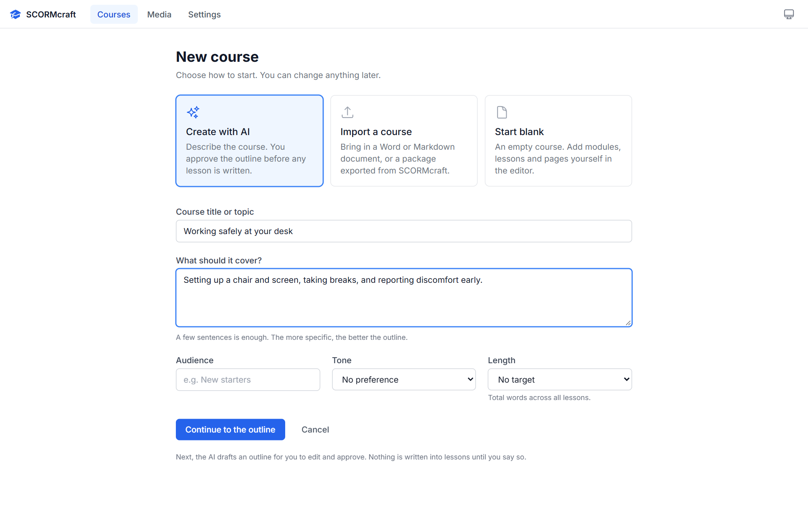
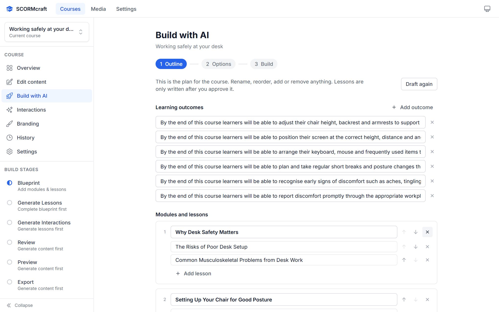
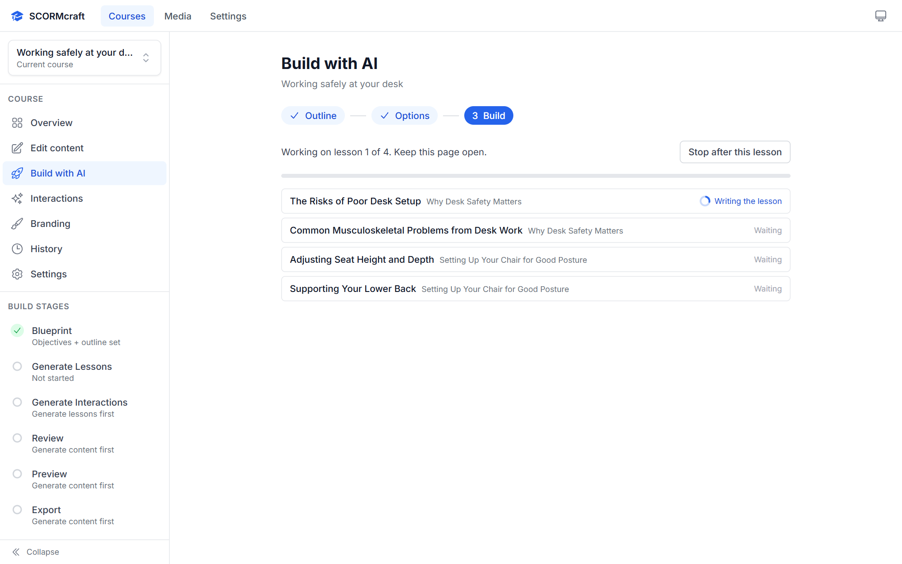
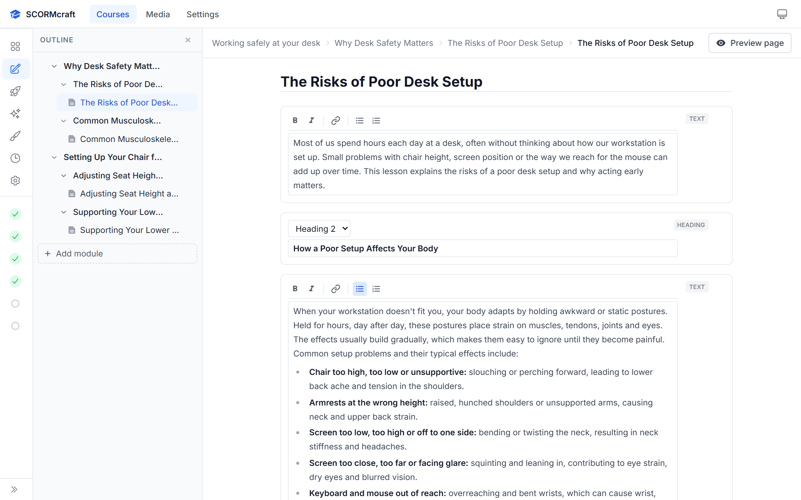
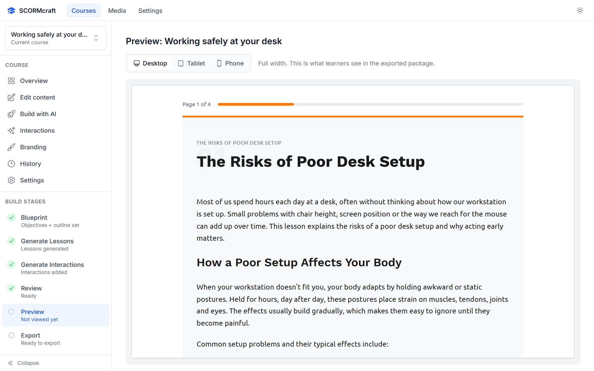
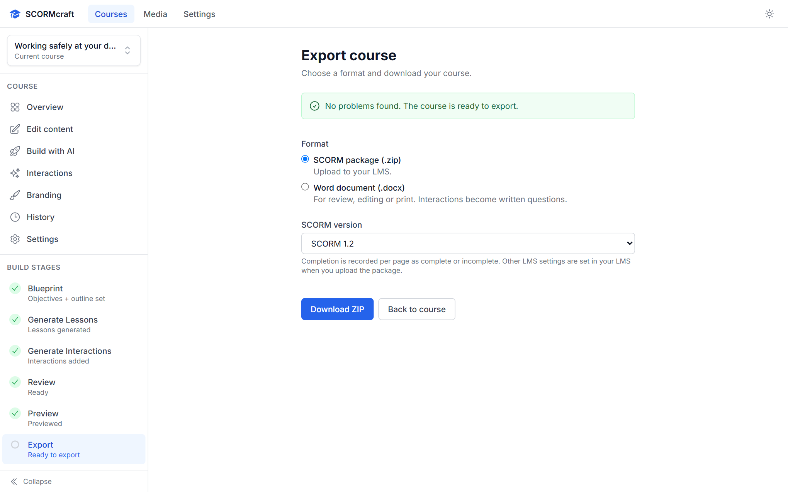

# SCORMcraft user guide

How to get from an idea, or an existing document, to a SCORM package in your LMS.

- [Before you start](#before-you-start)
- [Starting a course](#starting-a-course)
- [Building with AI](#building-with-ai)
- [Importing a course](#importing-a-course)
- [Editing](#editing)
- [Interactions](#interactions)
- [Images and files](#images-and-files)
- [History and restoring](#history-and-restoring)
- [Branding](#branding)
- [Review, preview and export](#review-preview-and-export)
- [Where your data is kept](#where-your-data-is-kept)

## Before you start

A course is made of **modules**. Each module holds **lessons**, each lesson holds **pages**, and each page is a stack of **blocks**: a paragraph, a heading, an image, a quiz question and so on.

If you want AI to write for you, set up a provider first. Open **Settings** in the top bar and either sign in to a Claude or ChatGPT subscription or add an API key. The [README](../README.md#ai-providers) lists what each option needs.

## Starting a course

Choose **New course**. There are three ways in.

| Option | Use it when | Where you land |
|---|---|---|
| **Create with AI** | You have a topic and want a first draft | The AI build, starting with an outline |
| **Import a course** | You have a Word or Markdown document, or a package exported from SCORMcraft | The editor, with your content as written |
| **Start blank** | You want to write it yourself | The editor, with an empty course |

## Building with AI

The build has three steps, and nothing is written into lessons until you approve the outline.

1. **Outline.** The AI drafts learning outcomes, modules and lessons. Rename, reorder, add or remove anything. **Draft again** asks for a fresh outline. When it's right, choose **Approve outline**.
2. **Options.** Choose whether to add interactions and how many.
3. **Build.** Lessons are written one at a time. You can see which lesson is in progress, and **Stop after this lesson** ends the run cleanly, keeping everything already written.

Lessons that already have content are skipped, so you can come back to **Build with AI** later to fill in new lessons without touching the ones you've edited.

## Importing a course

**Word or Markdown.** Choose **Import a course**, then your document. The AI reads the document to work out its modules, lessons and pages; your wording is kept as written. The import dialog has Word and Markdown templates you can download if you'd like to write to a known layout. Imported courses open in the editor.

**A SCORMcraft package.** A SCORM zip exported from SCORMcraft can be imported back as a fully editable course. Packages made by other authoring tools aren't supported.

## Editing

Open **Edit content** in the course sidebar.

**The outline** on the left shows modules, lessons and pages.

- Drag a row by its handle to reorder it. A lesson can be dragged into a different module.
- Each row's menu has Rename, Duplicate, Move up, Move down and Delete.
- The + beside a row adds a lesson or a page to it.

**Blocks** make up the page on the right.

- Click into a block to edit it. Changes save when you click away.
- Drag a block by its handle to move it, or use Move up, Move down and Move to top in its menu.
- The + between two blocks adds a new block at that position.
- **Rewrite with AI** shows the new version beside the current one. Choose **Replace**, **Insert below** to keep both, or **Discard**.

Content blocks: text, heading, image, video, key insight, key point, table and file download.

**Preview page** in the editor header opens the learner view at the page you're on.

## Interactions

Interaction blocks are added from the same block menu as content.

| Type | What the learner does |
|---|---|
| Multiple choice | Picks one answer from several |
| True or false | Judges a statement |
| Reflection | Writes a free-text response |
| Drag and drop | Puts items into the right order |
| Matching | Pairs each item with its partner |
| Flip cards | Turns a card over to check what's on the back |

Options, items, pairs and cards can be reordered with the arrows beside each one.

To add interactions across a course in one go, use **Interactions** in the sidebar, or tick **Add interactions** during an AI build. Lessons that already have interactions are skipped.

## Images and files

**Media** in the top bar is the library of everything you've uploaded. Images can be uploaded or, with a Google Gemini API key, generated from a description.

To give learners a file of their own, such as a worksheet or spreadsheet, see [Adding downloadable files](file-downloads.md).

## History and restoring

SCORMcraft saves a version of the course before anything that could lose work:

- before a lesson is regenerated,
- before a module, lesson or page is deleted,
- before a blueprint save that removes lessons,
- before a version is restored.

Open **History** in the sidebar to see them. **Save a version now** takes one whenever you like, and **Restore** puts the course back to any version in the list. The newest 25 are kept.

## Branding

**Branding** in the sidebar sets how the exported course looks to learners:

- primary, secondary and accent colours,
- heading and body fonts,
- a logo,
- one of three layouts: **Classic** (a tinted reading column under an accent line), **Card** (the page on a raised card) or **Banner** (a band of your primary colour across the top).

A preview on the page updates as you change things.

## Review, preview and export

**Review** checks the course before it goes out: reading time, coverage of the learning outcomes, accessibility and links.

**Preview** shows the course as a learner sees it, at desktop, tablet and phone widths.

**Export** lists anything still to fix, with a link to each, then downloads either:

- a **SCORM 1.2** package (`.zip`) to upload to your LMS, which reports completion and score, or
- a **Word document** (`.docx`) of the course content.

## Where your data is kept

Everything is on your computer, in `%APPDATA%\SCORMcraft\data`:

| Item | What it is |
|---|---|
| `scormcraft.db` | Your courses and their history |
| `files\` | Uploaded images and documents |
| `settings.json` | The AI provider you chose and any API keys |

To back up SCORMcraft, close the app and copy that folder. Uninstalling the app doesn't delete it.
